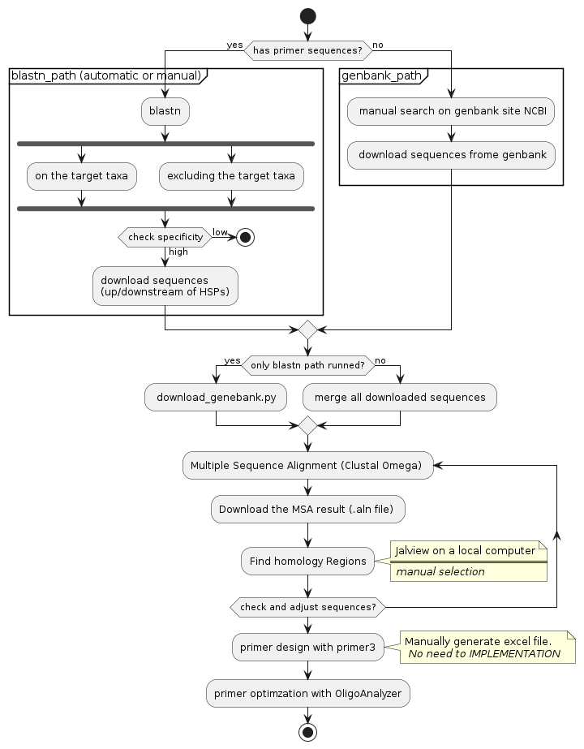

[](https://github.com/io2oi/ctlabs-primerwrapper/actions/workflows/pcr_analyzer-exe.yml)

# ctlabs-primerwrapper
ctlabs 에서 진행하는 primer 설계에 대한 자동화 프로그램

# 전체 워크플로우


# 사전 필요사항
## cd-hit (GPL license)
중복 제거하기 위해 필요한 프로그램 #17 [issue](https://github.com/io2oi/ctlabs-primerwrapper/issues/17) 참조
## clustalo
MSA program (참조: https://github.com/io2oi/ctlabs-primerwrapper/issues/11#issuecomment-1249347954)
## MAFFT
MSA program (참조: https://github.com/io2oi/ctlabs-primerwrapper/issues/110#issuecomment-1678117152)
```bash
sudo apt install mafft
```
## ncbi taxdump 파일
종명 자동완성 검색을 위해 필요
```
cd static/data/ori
wget -nd https://ftp.ncbi.nlm.nih.gov/pub/taxonomy/new_taxdump/new_taxdump.tar.gz
tar xzf new_taxdump.tar.gz
cd <flask mother directory>
python src/taxid_generator.py
```
### nt DB
```
$ update_blastdb.pl nt
```
위 명령어 실행 한 뒤 압축을 모두 풀어 주어야 함.
아래 환경설정에서 nt DB 자동 update 관련 항목 참조.

## EDirect
https://www.ncbi.nlm.nih.gov/books/NBK179288/
에 따라 설치 및 `.bashrc` 작업 필요

## NCBI+ 설치
https://blast.ncbi.nlm.nih.gov/Blast.cgi?PAGE_TYPE=BlastDocs&DOC_TYPE=Download
에 따라 설치
```
wget ftp://ftp.ncbi.nlm.nih.gov/blast/executables/blast+/LATEST/ncbi-blast*x64-linux.tar.gz
```
한 다음 $HOME/.local/bin 아래로 binary 들을 옮김

## 동등 및 하위 taxanomy id 리스트를 얻게 해주는 script 설치
`get_species_taxids.sh` 이며 위의 NCBI+ 설치시 같이 설치가 됨.
https://www.ncbi.nlm.nih.gov/books/NBK569846/
참조. 

## mfold 설치
#94 참조
http://www.unafold.org/mfold/software/download-mfold.php 에서 m-fold 를 내려받아 설치한다.
```bash
tar xzf <downloaded file>
sudo apt install gcc g++ gfortran
mkdir ~/.local # 참고로 내가 쓰는 WSL Ubuntu-22.04 에서는 ~/.local 을 PATH 에 자동으로 잡아 줌. .bashrc 에서 PATH 에 대해서 정의할 필요가 없음
 ./configure --prefix=$HOME/.local CXX=g++ CC=gcc F77=gfortran
make
make install
```
작업 완료 후 `.bashrc` 에 환경 설정이 필요하다. 아래 환경설정 참조

## oligodesiner 관련 GUI 환경 설정
https://github.com/io2oi/ctlabs-primerwrapper/issues/128 참조


# 환경설정
이 프로그램은 windows 의 WSL 에서 실행 하는 것을 기반으로 만들어졌다.
WSL 설정은 [issue 129](https://github.com/io2oi/ctlabs-primerwrapper/issues/129) 를 참고한다.

이 소스코드 저장소를 WSL내에 가져오기 위해서는 git clone 을 실행한다. ssh연결을 해야 하기 때문에 자신의 github 계정에 ssh public key 를 복사해 와야한다. ([참고자료연결](https://github.com/io2oi/ctlabs-primerwrapper/issues/130))

## 프로그램 실행을 위한 가상 환경 설치
```shell
$ python3 -m virtualenv .venv
$ source .venv/bin/activate
$ python -m pip install -r requirements.txt
```

## 프로그램 실행에 필요한 nt 자동 update crontab 설정
`crontab -e` 를 실행 한 뒤 다음과 같이 적어준다. 그러면 날마다 자정에 `$HOME` 디렉토리 아래에 blast_nt.log 파일에 업데이트 사항이 기록된다.
아래의 `run.sh`의 경로는 `config.yaml` 에 `NT` 에 적어주는 디렉토리 경로에 위치해야 한다. 예를 들어 `NT` 에 `/mnt/e/BLAST/nt`를 적었다면 다음과 같이 `crontab`에 적어준다.
```bash
00 00 * * * /mnt/e/BLAST/nt/run.sh >> blast_nt.log  2>&1
```
`run.sh`는 `scripts/blast_nt_update_template.sh` 를 열어 `MOTHDIR`에 `NT`디렉토리 경로를 적어준 뒤 복사해서 사용하면 된다.

## 프로그램 taxanomy 자동 완성을 위한 자동 설정
아래와 같이 crontab 에 설정하였다. 매일 저녁 11시에 실행
```bash
00 23 * * * /home/i-gene/git/ctlabs-primerwrapper/scripts/download_taxdb.sh >> taxid.log 2>&1
```
`download_taxdb.sh` 에 `FLASK_PATH` 를 설정하고 `static/data` 가 `config.yaml` 에 정의한 `TAX...PATH` 변수에 설정된 경로들을 확인한다.

## m-fold 를 사용하기 위한 `.bashrc` 설정
```bash
### for m-fold
export MFOLDBIN=$HOME/.local/bin
export MFOLDLIB=$HOME/.local/share/mfold
```

# 프로그램 실행 전 실행 (python 환경 활성)
```shell
$ source .venv/bin/activate
```

# config.yaml 형식
```yaml
email:
    <your@email>
SLEEPTIME: #blastn all 이후 blastn excluding taxa 를 실행하기까지 쉬는 시간
    10
TEMPDIR: #blastn, genebank download 등 결과물이 저장되는 디렉토리 이름
    tempdir
TESTQ: ## if True, jobid (uuid) is fixed and blastn result files are re-used
    True
TAXORIPATH: # ncbi 에서 내려받은 fullnamelineage.dmp 파일 위치. 현재는 static 디렉토리 아래에 있다는 가정을 하고 있다. 
   data/ori/fullnamelineage.dmp
TAXJSPATH: # The path of TxGenerator.gen_js() output json file. 현재는 static 디렉토리 아래에 있다는 가정을 하고 있다.
   data/fullnamelineage.js
TAXDBPATH: # sqlite3 파일. TAXJSPATH 와 똑같은 내용.
  data/fullnamelineage.db
AUTOCOMPLETESIZE: #exclude taxa 에서 사용하는 리턴 최대치. 너무 크면 메모리 문제
    10
HITLISTSIZE: # blast query 시에 hit 의 최대 갯수 지정.
   10000
BLASTN: # standalone blastn 의 경로
  <`which blastn`>
NT: # nt 디렉토리의 경로
  <nt 위치. nt.00.* 등의 파일들이 있는 위치>
SC_TAXSEARCH: # stanalone blastn+ 를 실행할 때 -negative_taxidlist 에 exclude taxanomy id 와 같은 수준 및 그 이하의 taxid 들을 모두 넣어 주기 위해 필요한 스크립트 경로
  <`which get_species_taxids.sh`>
GB_STORAGE: # genbank gb file 이 저장되는 장소 별도 지정.
  <`pwd` @ <GBpath>>
FA_STORAGE: # Entrez 에서 가지고 오는 FASTA 파일 저장소
   <FASTA 저장소>
```
# 전체 사용법
[구글 드라이브 파일](https://docs.google.com/presentation/d/1XmJDRyA7jnudOW_b4-qW4zZAwjav5rX1LJsz4Eth89A/edit#slide=id.p)

# script 설명
command line 작업 용.
## xml 을 수동으로 NCBI 에서 수행 한 후에 clustalo 까지 진행하는 script
```scripts/xml_to_aln.sh`` 를 사용하면 된다.
사용법
```bash
$ scripts/xml_to_msa.sh 
 This is a bash script for running src/download_genebank.py in command line.
 Usage:
     xml_to_msa.sh A.xml B.xml C.xml ...
 Output:
     tempdir/job`date +%Y%m%d`_{A,B,C,...}-<qseq>-genebank.fasta
     tempdir/job`date +%Y%m%d`_{A,B,C,...}-<qseq>-genebank.aln
```
